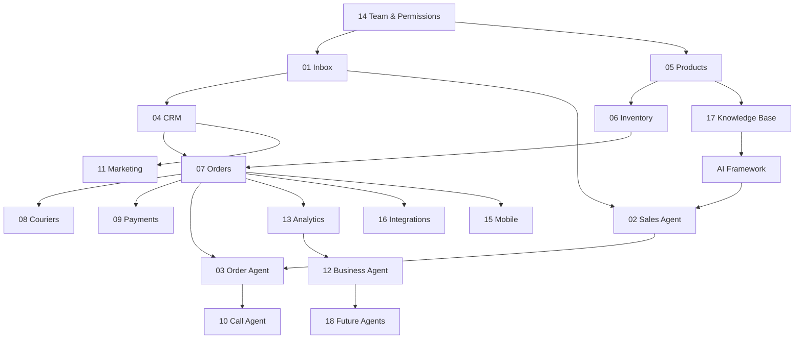

# Roadmap and Delivery Phases (Proposed)

Phase scope is a proposal for planning; confirm against team capacity and customer feedback. Durations are intentionally omitted.

**What is actually built:** see `implementation-status.md` (audited 2026-11-05).

## Phase 1: MVP (chat to delivered order)
Goal: a seller can receive chats, let AI answer and capture orders, ship via courier and track COD.

| Area | Included |
| --- | --- |
| Foundation | Multi-tenant workspaces, auth, roles, audit (`14`) |
| Inbox | Messenger, Instagram, WhatsApp, website chat; assignment, notes, tags, saved replies, search (`01`) |
| Catalog and stock | Products, variants, SKU/barcode, single or few warehouses, purchase entry, adjustments, reservations, low-stock alerts (`05`, `06`) |
| Connection modes | Built-in **manual/no-website** mode and **social commerce** (Messenger, Instagram, WhatsApp, web chat) as first-class sales channels; onboarding offers all five connection paths with Shopify/WooCommerce/custom API shown as "coming soon" until P2 (`19`, `16`) |
| Integration foundation | Canonical `source` + `ExternalMapping` + idempotent order intake designed in P1 so P2 connectors add no new order logic (`16`, `domain-model.md`) |
| Orders | Manual + AI orders, full status flow, invoices, returns basics, bulk actions (`07`) |
| Couriers | SteadFast, Pathao, manual delivery; tracking; basic COD view (`08`). **Status 2026-11-01:** accounts, booking, tracking, dashboard and parcels list built; COD reconciliation, returns/cancel screens and customer tracking page remain (`courier-delivery-plan.md` section 0) |
| Payments | Payment links with bKash + SSLCommerz; manual TrxID flow; SaaS plan billing (`09`). **Status 2026-11-05:** framework and aamarPay (sandbox-verified) built with payment links, hosted pay page, send-in-chat and a transactions dashboard; refunds, needs-review queue, prepayment rules, manual TrxID, SaaS billing and the other gateways remain (`implementation-status.md` section 2, `payment-gateway-framework.md` section 16) |
| CRM | Profiles, timeline, stats, basic segments, consent (`04`) |
| AI | Framework, Knowledge Base (FAQ, policies, products), Sales Agent, Order Agent (Levels 1–3); customer **images** (context-aware product match and details, payment-proof and issue photos) and **voice notes** (transcribed, answered as text) (`02`, `03`, `17`, `01` FR-INB-12a/16) |
| AI providers | Provider layer with ports, routing config, Gemini adapter, OpenAI-compatible adapter (proves offline path), PII masking, eval harness (`llm-provider-layer.md`) |

Exit criteria: pilot sellers process live orders end to end; AI price/stock correctness audit has zero failures; ≥ 30% of conversations AI-assisted; reservation and ledger reconcile daily with zero mismatch.

## Admin panel track (separate product)
The staff-only admin panel is specified in `../05-admin-panel/` and built on its own milestones (M0 to M7 in `build-plan.md`). Release 1 (foundation, workspaces, AI models, AI usage and budgets) is P1 because sellers cannot be supported or AI cost controlled without it; live activity, billing and operations extras are P2.

## Phase 2: Growth (scale, insight, automation)
| Area | Included |
| --- | --- |
| Analytics | Dashboards, metric service, cohorts (`13`) |
| AI | Business Agent, quotations, upsell, embedding quality work for image search (P1 already supports embeddings when configured, and attribute matching otherwise), synthesized voice replies, learn-from-chat (`12`, `02`) |
| Marketing | Campaigns (WhatsApp/SMS/Messenger), automations, coupons, attribution (`11`) |
| Fulfillment | RedX (**built early, 2026-11-01**, sandbox-tested), Paperfly, eCourier; COD settlement import; multi-warehouse, transfers (`08`, `06`) |
| Payments | Nagad, Rocket, subscription groundwork, auto-verification (`09`) |
| Integrations | Connector framework (capability manifest, sync jobs, reconciliation dashboard), then Shopify (**built early, 2026-11**: import, stock and catalog push, webhooks, refund write-back; unit-tested, no live-store run yet), WooCommerce, custom website API (`16`) |
| Mobile | Seller App (Android first), Warehouse App (`15`) |
| Platform | Custom roles, 2FA, Telegram, email, SLA monitoring (`14`, `01`) |

## Phase 3: Expansion (voice, ecosystem, digital team)
| Area | Included |
| --- | --- |
| AI | Call Agent (Bangla voice), Support, Inventory, Marketing, Finance, CEO agents (`10`, `18`) |
| Integrations | Daraz, Sundarban, Chaldal (if available), TikTok (`16`, `01`) |
| Operations | Batch and serial tracking, stock count, Delivery App, cross-seller fraud network (opt-in) (`06`, `15`, `03`) |
| Platform | Custom dashboards, enterprise SSO, A/B testing |
| Commerce | Hosted storefront (shareable store page and checkout, "Level 3"), additional commerce platforms (`16`) |

## Integration build order (within the phases above)

| Step | Deliverable | Phase |
| --- | --- | --- |
| 1 | Workspace, products, customers, orders, manual order creation | P1 |
| 2 | Connector framework: external ID mappings, sync jobs, webhook processing, idempotency | P1 foundations, P2 complete |
| 3 | Shopify | P2 |
| 4 | WooCommerce | P2 |
| 5 | Custom API and webhooks | P2 |
| 6 | Facebook and other messaging channels | P1 (Messenger, Instagram, WhatsApp, web chat) |
| 7 | Inventory sync, fulfillment integrations, AI automation | P1-P2 |
| 8 | Hosted storefront, extra commerce platforms | P3 |

Messaging (step 6) ships in P1 because it is the core of the Bangladesh F-commerce use case; the common data model and integration framework stay ahead of every individual connector.

## AI provider strategy (cross-phase)

| Stage | When | Providers | Data |
| --- | --- | --- | --- |
| A. Development | During P1 build | Gemini for all text tasks (plus a small local model for adapter testing) | Synthetic only |
| B. Pilot | P1 exit | Paid cloud API under production terms, PII masked; self-hosted candidates in shadow mode | Masked real data |
| C. Hybrid | P2 | High-volume tasks (classify, extract, embeddings) self-hosted; hard tasks cloud with fallback | Masked / internal |
| D. Offline-first | P2–P3 | Self-hosted default; cloud optional; `self_hosted_only` workspace mode | Full, internal |

Details and the model-switch evaluation gate: `../01-architecture/llm-provider-layer.md` §9–10.

## Dependency graph (build order)

## Top risks
| Risk | Mitigation |
| --- | --- |
| Connector-specific logic leaking into core order/inventory code | Canonical model only; connectors translate at the edge; capability manifest; contract tests with recorded fixtures |
| Two-way sync overwriting data or corrupting stock | Explicit field ownership, platform is stock source of truth, reconciliation dashboard |
| Meta/WhatsApp policy or API changes | Adapter layer, early app review, template management, fallback to web chat |
| Courier API instability or limits | Retry queues, health dashboards, manual fallback |
| AI wrong price/stock | Tool-only facts, validators, eval suite, autonomy ladder |
| Bangla speech/text quality | Early benchmarks, human-in-the-loop, feedback capture |
| Fake COD orders | Risk scoring, confirmation flows, prepayment rules |
| Tenant data leaks | Mandatory tenant filters, isolation tests in CI |
| AI cost overrun | Budgets, caching, smaller models for classification |
| Vendor lock-in or data-terms problem with one AI provider | Ports and adapters, routing config, eval gate, `self_hosted_only` mode |
| Sending real customer data to an untrusted AI endpoint during testing | Synthetic-data-only rule for dev providers, PII masking, route guards |
