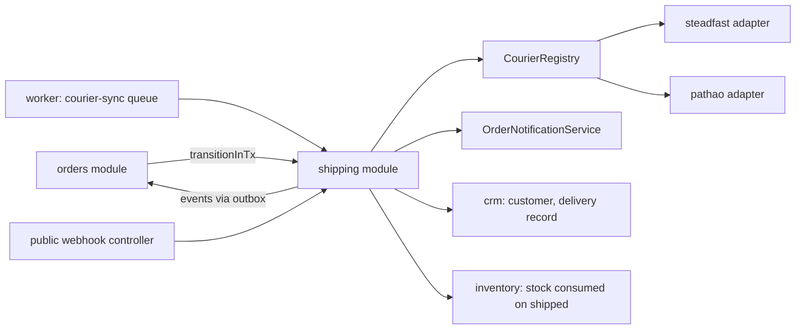
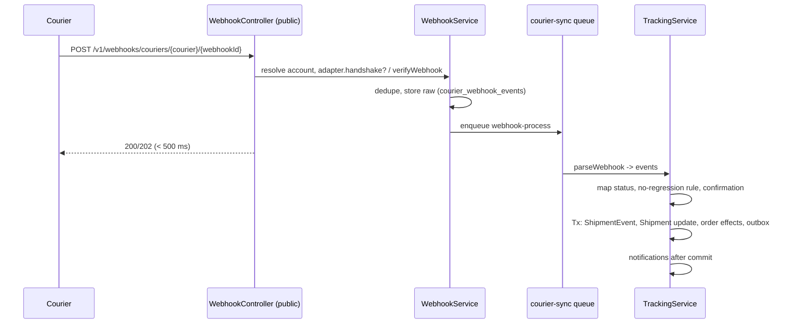

# Courier Integration: Technical Design

Status: v0.1 (2026-11-01). Implementation-level design for `../02-customer-features/08-courier-integration.md` on top of
`courier-adapter-framework.md`, for SteadFast (`../03-customer-integrations/couriers/steadfast.md`) and Pathao (`../03-customer-integrations/couriers/pathao.md`).
Companion documents: `courier-api-contract.md` (REST), `../02-customer-features/08-courier-integration-ux.md` (screens and copy),
`../04-customer-operations/courier-runbook.md` (operating it), `../00-overview/courier-delivery-plan.md` (work breakdown and rollout).

If this document and a provider document disagree about a provider's behavior, the provider document wins; if they disagree about platform design, this document wins.

## 1. Scope

In scope: connect courier accounts, book consignments (single and throttled bulk), track by webhook and polling, cancel/return handling, labels, customer
messages, COD reconciliation, delivery-record checks, rate tables, operations tooling.
Out of scope: courier pickup scheduling beyond what the APIs offer, the Delivery App, hosted storefront, marketplace couriers (Daraz and others).

## 2. Prerequisites in the existing codebase (must land first)

The current code was written before couriers. These gaps block a correct implementation; they are Epic 0 in the delivery plan.

| # | Gap today | Required change |
| --- | --- | --- |
| P1 | `Order.shippingAddress` is `{ name, phone, line1, city, region, postalCode, country }` (`orders-create.ts`). Couriers need Bangladesh structure: division, district, upazila/thana, area. | **Address v2** JSON: `{ name, phone, altPhone?, division, district, upazilaOrThana, area?, addressLine, postalCode?, landmark?, geo? }` (conventions section 2.5) with a compatibility reader for v1 (`line1` -> `addressLine`, `city` -> `district`, `region` -> `division`). Order create/edit forms and AI order capture get a Bangladesh location picker backed by a seeded `bd_locations` dataset. Existing orders keep v1 and are shown with "complete address to ship". |
| P2 | `Order` has no weight; variants have `weightG` | Order weight = sum(`variant.weightG` x quantity), missing weights use the workspace default; shown and editable at booking. |
| P3 | Order state machine requires `packed` before `shipped` (`order-status.ts`), and stock is consumed on `shipped` (`orders.service.ts`) | Booking requires status `packed`. If the order is `confirmed` and workspace setting `courier.autoPackOnBooking` is true (default), the booking transaction performs `confirmed -> packed -> shipped` in sequence with history rows. |
| P4 | `OrdersService.transition` opens its own transaction | Extract `transitionInTx(tx, ctx, orderId, to, reason, opts)` so `BookingService`/`TrackingService` can transition inside their transaction (stock consumption, history and optimistic version check unchanged). |
| P5 | `shipments` table is minimal and `ShippingModule` is empty | Migration in section 4. |
| P6 | No customer notification service for order events | `OrderNotificationService` using the inbox outbound path (conversation exists) with email/SMS fallback later; templates in the UX spec. |
| P7 | No rate table / shipping settings | `CourierRateTable` (section 4) and workspace shipping settings. |
| P8 | `OrdersQueryService` returns a tiny shipment DTO; the AI tool reads `trackingCode`/`courier` | Extend the DTO (section 4.1 of the API contract) and make the AI tool and the order screens use `trackingCode ?? consignmentId`, `trackingUrl`, and the courier display name. |

## 3. Architecture

### 3.1 Modules and dependencies



Rules: `shipping` depends on `orders` (transition API) and not the other way round except through events. Adapters know nothing about Prisma, Nest or the order domain; they speak the types in the framework contract.

### 3.2 Folder layout (extends the framework)

```text
apps/api/src/modules/shipping/
  shipping.module.ts
  api/
    courier-accounts.controller.ts   shipments.controller.ts   courier-webhooks.controller.ts (public)
    tracking.controller.ts (public)  cod.controller.ts         shipping-settings.controller.ts
  application/
    courier-registry.ts  courier-account.service.ts  booking.service.ts  tracking.service.ts
    webhook.service.ts  settlement.service.ts  risk-check.service.ts  rate-table.service.ts
    label.service.ts  coverage.service.ts  courier-selection.service.ts  booking-reaper.service.ts
  domain/
    shipment-status.ts (unified enum, rank, transitions)   booking-state.ts   reference.ts
    address-formatters.ts  phone.ts  money.ts  errors.ts  order-effects.ts
  infra/couriers/…                    (framework section 3)
  workers/
    poll.processor.ts  webhook-process.processor.ts  settlement-sync.processor.ts  coverage-sync.processor.ts
    token-renew.processor.ts  validate-account.processor.ts  booking-recover.processor.ts
  tests/
```

### 3.3 Sequence: booking

```mermaid
sequenceDiagram
  participant UI
  participant API as ShipmentsController
  participant B as BookingService
  participant DB as Postgres
  participant A as CourierAdapter
  participant C as Courier
  participant O as OrdersService
  UI->>API: POST /orders/{id}/shipments (Idempotency-Key)
  API->>B: book(orderId, accountId?, options)
  B->>DB: Tx1: validate order, pick account, build BookingRequest, insert Shipment(booking_state=booking, reference)
  Note over B,DB: commit; no HTTP call inside a transaction
  B->>A: book(account, request)
  A->>C: POST create order
  alt clear success
    C-->>A: consignment
    A-->>B: BookingResult
    B->>DB: Tx2: Shipment booked + ShipmentEvent
    B->>O: transitionInTx(order -> packed? -> shipped)
    B->>DB: outbox shipping.shipment.booked + audit
    B-->>UI: 201 shipment
  else clear failure (validation)
    A-->>B: CourierError(validation_failed)
    B->>DB: Tx2: booking_state=failed, booking_error
    B-->>UI: 422 with per-field messages
  else ambiguous (timeout/5xx)
    A-->>B: CourierError(courier_down)
    B->>DB: Tx2: booking_state=booking_unknown
    Note over B,C: SteadFast: findByReference auto-recovery. Pathao: no auto retry, task + webhook assist
    B-->>UI: 202 "checking with courier"
  end
```

Failure inside Tx2 after the courier already created the parcel (for example stock consumption fails): the shipment stays `booked`, the order gets a `needs_attention` flag, and `booking-recover` retries Tx2 idempotently (section 6). The parcel is never "forgotten".

### 3.4 Sequence: webhook



## 4. Data model (Prisma)

All tenant tables carry `workspaceId` and get Row-Level Security via `prisma/sql/post-migrate.sql` (add to `tenant_tables`). New ID prefixes in `packages/domain/src/ids.ts`: `courierWebhookEvent: "cwe"`, `shipmentEvent: "shv"`, `codSettlement: "cst"`, `codSettlementLine: "csl"`, `courierBalanceSnapshot: "cbs"`, `courierRule: "crl"`, `courierAddressChoice: "cac"`, `courierRiskCache: "crc"`, `courierRateTable: "crt"` (existing: `shipment: "shp"`, `courierAccount: "cou"`).

```prisma
/// One connected courier account (SteadFast profile, Pathao merchant...). Secrets are encrypted with CredentialCipher.
model CourierAccount {
  id                       String    @id
  workspaceId              String    @map("workspace_id")
  courier                  String                                   // steadfast | pathao | redx | paperfly | ecourier | sundarban | manual
  label                    String
  environment              String    @default("live")               // sandbox | live
  status                   String    @default("ok")                 // ok | error | restricted | paused
  errorCode                String?   @map("error_code")
  errorMessage             String?   @map("error_message")
  credentialsEncrypted     String    @map("credentials_encrypted")  // JSON per courier (never returned by the API)
  tokensEncrypted          String?   @map("tokens_encrypted")       // OAuth couriers
  tokenExpiresAt           DateTime? @map("token_expires_at")
  /// sha256 of the primary credential; one courier account belongs to exactly one workspace.
  credentialsFingerprint   String    @map("credentials_fingerprint")
  webhookId                String    @unique @map("webhook_id")     // unguessable, in the callback URL
  webhookSecretEncrypted   String?   @map("webhook_secret_encrypted")
  webhookIntegrationSecretEncrypted String? @map("webhook_integration_secret_encrypted")
  lastWebhookAt            DateTime? @map("last_webhook_at")
  settings                 Json      @default("{}")                 // defaults, store map, pickup config (see 4.1)
  codEnabled               Boolean   @default(true) @map("cod_enabled")
  isDefault                Boolean   @default(false) @map("is_default")
  active                   Boolean   @default(true)
  lastValidatedAt          DateTime? @map("last_validated_at")
  lastBalanceAmount        Int?      @map("last_balance_amount")
  lastBalanceAt            DateTime? @map("last_balance_at")
  createdBy                String?   @map("created_by")
  createdAt                DateTime  @default(now()) @map("created_at")
  updatedAt                DateTime  @updatedAt @map("updated_at")

  @@unique([courier, credentialsFingerprint])
  @@index([workspaceId, courier])
  @@map("courier_accounts")
}

model Shipment {                       // extends the existing table (migration adds columns)
  id                    String    @id
  workspaceId           String    @map("workspace_id")
  orderId               String    @map("order_id")
  courierAccountId      String?   @map("courier_account_id")
  courier               String
  reference             String                                         // idempotency key sent to the courier (ORD-000123, ORD-000123-R2)
  attempt               Int       @default(1)
  bookingState          String    @default("requested") @map("booking_state") // requested | booking | booked | booking_unknown | failed
  bookingError          Json?     @map("booking_error")                // normalized error + per-field messages
  consignmentId         String?   @map("consignment_id")
  trackingCode          String?   @map("tracking_code")
  trackingUrl           String?   @map("tracking_url")
  status                String    @default("pending")                  // unified status (framework 4.2)
  confirmation          String    @default("confirmed")                // confirmed | pending
  returnState           String    @default("none") @map("return_state") // none | processing | rider_assigned | received
  returnRequested       Boolean   @default(false) @map("return_requested")
  courierStatusRaw      String?   @map("courier_status_raw")
  zoneUnmapped          Boolean   @default(false) @map("zone_unmapped")
  requestSnapshot       Json?     @map("request_snapshot")             // the BookingRequest we sent (PII redacted in logs, kept here for support)
  rawBooking            Json?     @map("raw_booking")                  // courier response, secrets redacted
  codAmount             Int       @default(0) @map("cod_amount")       // expected COD, poisha
  codCollectedAmount    Int?      @map("cod_collected_amount")
  deliveryChargeAmount  Int       @default(0) @map("delivery_charge_amount")
  deliveryChargeIsEstimate Boolean @default(true) @map("delivery_charge_is_estimate")
  codFeeAmount          Int       @default(0) @map("cod_fee_amount")
  netPayableAmount      Int?      @map("net_payable_amount")
  settlementStatus      String    @default("pending") @map("settlement_status") // pending | partial | settled | disputed
  lastPolledAt          DateTime? @map("last_polled_at")
  lastEventAt           DateTime? @map("last_event_at")
  nextPollAt            DateTime? @map("next_poll_at")
  publicToken           String    @unique @map("public_token")         // customer tracking page, random 22 chars
  bookedAt              DateTime? @map("booked_at")
  deliveredAt           DateTime? @map("delivered_at")
  createdAt             DateTime  @default(now()) @map("created_at")
  updatedAt             DateTime  @updatedAt @map("updated_at")
  order                 Order     @relation(fields: [orderId], references: [id])
  events                ShipmentEvent[]

  @@unique([courierAccountId, reference])
  @@unique([courierAccountId, consignmentId])
  @@index([workspaceId, orderId])
  @@index([workspaceId, status, nextPollAt])
  @@index([workspaceId, settlementStatus, status])
  @@map("shipments")
}

model ShipmentEvent {
  id               String   @id
  workspaceId      String   @map("workspace_id")
  shipmentId       String   @map("shipment_id")
  source           String                                   // webhook | poll | manual | system
  courierEvent     String?  @map("courier_event")           // webhook event name or null
  courierStatusRaw String?  @map("courier_status_raw")
  unifiedStatus    String?  @map("unified_status")          // status this event mapped to (null = informational)
  applied          Boolean  @default(false)                 // true if it changed Shipment.status
  message          String?
  location         String?
  idempotencyKey   String?  @map("idempotency_key")
  occurredAt       DateTime @map("occurred_at")             // courier time converted to UTC
  receivedAt       DateTime @default(now()) @map("received_at")
  raw              Json?
  shipment         Shipment @relation(fields: [shipmentId], references: [id], onDelete: Cascade)

  @@index([shipmentId, occurredAt])
  @@map("shipment_events")
}

model CourierWebhookEvent {
  id               String   @id
  workspaceId      String   @map("workspace_id")
  courierAccountId String   @map("courier_account_id")
  idempotencyKey   String   @map("idempotency_key")         // courier key, else sha256(raw body)
  eventType        String   @map("event_type")
  status           String   @default("received")            // received | processed | ignored | failed
  rawPayload       Json     @map("raw_payload")
  error            String?
  receivedAt       DateTime @default(now()) @map("received_at")
  processedAt      DateTime? @map("processed_at")

  @@unique([courierAccountId, idempotencyKey])
  @@index([workspaceId, status, receivedAt])
  @@map("courier_webhook_events")
}

model CodSettlement {
  id                  String   @id
  workspaceId         String   @map("workspace_id")
  courierAccountId    String   @map("courier_account_id")
  statementRef        String   @map("statement_ref")        // SteadFast payout number, Pathao invoice id/file name
  source              String                                  // api | csv | manual
  periodStart         DateTime? @map("period_start")
  periodEnd           DateTime? @map("period_end")
  totalCollectedAmount Int     @default(0) @map("total_collected_amount")
  totalFeesAmount     Int      @default(0) @map("total_fees_amount")
  netAmount           Int      @default(0) @map("net_amount")
  status              String   @default("pending")           // pending | partial | settled | disputed
  paidAt              DateTime? @map("paid_at")
  importedBy          String?  @map("imported_by")
  importedAt          DateTime @default(now()) @map("imported_at")
  lines               CodSettlementLine[]

  @@unique([courierAccountId, statementRef])
  @@map("cod_settlements")
}

model CodSettlementLine {
  id              String   @id
  workspaceId     String   @map("workspace_id")
  settlementId    String   @map("settlement_id")
  shipmentId      String?  @map("shipment_id")              // null = unmatched
  courierRef      String   @map("courier_ref")              // consignment id / invoice from the statement
  collectedAmount Int      @map("collected_amount")
  feeAmount       Int      @default(0) @map("fee_amount")
  chargeAmount    Int      @default(0) @map("charge_amount")
  netAmount       Int      @map("net_amount")
  matched         Boolean  @default(false)
  variance        String?                                   // collected_mismatch | net_mismatch | unknown_ref
  raw             Json?
  settlement      CodSettlement @relation(fields: [settlementId], references: [id], onDelete: Cascade)

  @@index([workspaceId, matched])
  @@index([shipmentId])
  @@map("cod_settlement_lines")
}

model CourierBalanceSnapshot {
  id               String   @id
  workspaceId      String   @map("workspace_id")
  courierAccountId String   @map("courier_account_id")
  amount           Int
  takenAt          DateTime @default(now()) @map("taken_at")
  @@index([courierAccountId, takenAt])
  @@map("courier_balance_snapshots")
}

/// Ordered selection rules (FR-CUR-03). `conditions` is a small JSON filter tree: zone, value range, weight range, tags.
model CourierRule {
  id               String @id
  workspaceId      String @map("workspace_id")
  priority         Int
  conditions       Json
  courierAccountId String @map("courier_account_id")
  active           Boolean @default(true)
  @@index([workspaceId, priority])
  @@map("courier_rules")
}

/// Workspace rate table for couriers without an estimate API (FR-CUR-64).
model CourierRateTable {
  id               String   @id
  workspaceId      String   @map("workspace_id")
  courierAccountId String   @map("courier_account_id")
  rows             Json                                     // [{ zone: "dhaka|outside", maxWeightG, amount }]
  codPercentBp     Int      @default(100) @map("cod_percent_bp")   // basis points, 100 = 1%
  returnChargeAmount Int    @default(0) @map("return_charge_amount")
  updatedAt        DateTime @updatedAt @map("updated_at")
  @@unique([courierAccountId])
  @@map("courier_rate_tables")
}

model CourierAddressChoice {                              // remembered manual zone choices (FR-CUR-11)
  id          String @id
  workspaceId String @map("workspace_id")
  courier     String
  addressKey  String @map("address_key")                  // normalized district|thana|area
  cityId      Int?   @map("city_id")
  zoneId      Int?   @map("zone_id")
  areaId      Int?   @map("area_id")
  @@unique([workspaceId, courier, addressKey])
  @@map("courier_address_choices")
}

model CourierRiskCache {
  id          String   @id
  workspaceId String   @map("workspace_id")
  courier     String
  phoneHash   String   @map("phone_hash")                 // sha256, never the number
  signal      Json
  fetchedAt   DateTime @default(now()) @map("fetched_at")
  @@unique([workspaceId, courier, phoneHash])
  @@map("courier_risk_cache")
}

/// GLOBAL reference data (no workspace_id, no RLS): courier coverage (Pathao city/zone/area).
model CourierCoverage {
  id         String  @id
  courier    String
  environment String @default("live")
  cityId     Int     @map("city_id")
  cityName   String  @map("city_name")
  zoneId     Int?    @map("zone_id")
  zoneName   String? @map("zone_name")
  areaId     Int?    @map("area_id")
  areaName   String? @map("area_name")
  homeDeliveryAvailable Boolean @default(true) @map("home_delivery_available")
  pickupAvailable       Boolean @default(true) @map("pickup_available")
  normalizedKey String @map("normalized_key")             // normalized names for matching
  syncedAt   DateTime @default(now()) @map("synced_at")
  @@index([courier, environment, normalizedKey])
  @@map("courier_coverage")
}
```

Order additions: `Order.shippingAddress` becomes address v2 (JSON, no column change); new optional `Order.weightGrams Int?` cache (recomputed on item change) and `Order.needsAttention Boolean @default(false)`.

### 4.1 `CourierAccount.settings` (validated by Zod per courier)

```json
{
  "deliveryType": "home",                 // SteadFast 0/1, Pathao 48/12 mapped by the adapter
  "defaultWeightGrams": 500,
  "codEnabled": true,
  "autoBook": { "enabled": false, "when": "packed" },
  "pathao": { "loginMethod": "client_credentials", "defaultStoreId": 12345, "storeMap": { "whs_...": 12345 }, "itemType": 2 },
  "steadfast": { "pickupAddressId": 42, "policeStationId": 17, "pickupContact": "01712345678" }
}
```

### 4.2 Constraints and indexes (SQL in `post-migrate.sql`)

```sql
-- One active booking per order per account (FR-CUR-23).
CREATE UNIQUE INDEX IF NOT EXISTS shipments_one_active_per_order
  ON shipments (workspace_id, order_id, courier_account_id)
  WHERE booking_state IN ('requested','booking','booking_unknown','booked') AND status NOT IN ('cancelled','returned');

ALTER TABLE shipments ADD CONSTRAINT shipments_status_valid CHECK (status IN
  ('pending','booked','picked_up','in_transit','out_for_delivery','delivered','partially_delivered','on_hold','failed','returning','returned','cancelled','exception'));
ALTER TABLE shipments ADD CONSTRAINT shipments_booking_state_valid CHECK (booking_state IN ('requested','booking','booked','booking_unknown','failed'));
ALTER TABLE shipments ADD CONSTRAINT shipments_confirmation_valid CHECK (confirmation IN ('confirmed','pending'));
```

RLS: add `courier_accounts, shipments, shipment_events, courier_webhook_events, cod_settlements, cod_settlement_lines, courier_balance_snapshots, courier_rules, courier_rate_tables, courier_address_choices, courier_risk_cache` to `tenant_tables`. `courier_coverage` is global and readable by the app role. The public webhook and tracking controllers use the admin client to resolve the account/shipment by unguessable id, then switch to `TenantTransaction.runFor` for all writes.

### 4.3 Migration plan

1. Migration `20261105_courier_core`: alter `shipments` (new columns with safe defaults; backfill `reference = 'ORD-' || lpad(order number)`, `public_token`, `booking_state='booked'` for rows with a `consignment_id`), create the new tables, indexes. Existing rows have `courier_account_id = null` (manual shipments): allowed.
2. `post-migrate.sql` additions above; `pnpm db:rls`.
3. IDs, `ALL_PERMISSIONS` unchanged (shipping permissions exist).
4. Data retention: `courier_webhook_events.raw_payload` and `shipment_events.raw` are redacted copies kept 12 months, then nulled by a retention job; `request_snapshot`/`raw_booking` follow order retention.

## 5. Domain rules

### 5.1 Unified statuses and ranks

Defined once in `domain/shipment-status.ts`:

```ts
export const SHIPMENT_STATUSES = ["pending","booked","picked_up","in_transit","out_for_delivery","delivered","partially_delivered","on_hold","failed","returning","returned","cancelled","exception"] as const;
// Forward-only ranks (framework 5.2). Equal rank = side-by-side outcomes of the same stage.
export const RANK = { pending:0, booked:1, picked_up:2, in_transit:3, out_for_delivery:4,
  delivered:5, partially_delivered:5, failed:5, on_hold:5, exception:5, returning:6, returned:7, cancelled:99 } as const;
```

`applyStatus(current, next, {explicitReversal})`: apply if `RANK[next] > RANK[current]`, or equal rank and `next` differs with `delivered` never replaced by `failed`/`on_hold` (and the reverse allowed only with `explicitReversal`), `cancelled` is terminal, `on_hold` clears when a later-rank event arrives. Returns `{ apply: boolean, reason }`. Property-tested with fast-check (framework test suite).

### 5.2 Order effects (`domain/order-effects.ts`)

| Shipment change (confirmed) | Order action (inside the same transaction) |
| --- | --- |
| booked (first time) | `packed -> shipped` (with optional `confirmed -> packed` first), stock consumed by the existing transition |
| `delivered` | order `shipped -> delivered`; COD recorded as collected-awaiting-settlement (no Payment yet) |
| `partially_delivered` | order `delivered` + `Return(type=courier_return, partial=true)` for undelivered items; COD manual flag |
| `returning` | create `Return(type=courier_return)` if none; order stays `shipped` |
| `returned` (received at warehouse) | order `shipped -> returned`; return QC path (`07`) decides restock |
| `cancelled` | order `shipped -> ` not allowed by the state machine; therefore cancellation **before** `shipped` is not possible after booking. A cancelled consignment returns the order to `confirmed` through the explicit domain operation `reopenAfterCourierCancel(orderId)` (history row, stock restored via `cancelOrderStock`-style reversal, reservation re-created). New to the order domain: documented in `07` as a controlled exception. |
| `failed`, `on_hold`, `exception` | order flag + Support task, no status change |

Customer messages are queued after commit, never inside the transaction.

### 5.3 Booking reference

`reference(orderNumber, attempt)` = `ORD-000123` for attempt 1, `ORD-000123-R{attempt}` after. `attempt` increments only when the previous shipment reached `cancelled`, `returned`, or `failed` **with a consignment** (the courier may hold the old reference forever). A local validation failure or "not booked" resolution reuses the same attempt/reference.

### 5.4 Formatters (pure, unit-tested; adapters call them)

| Function | Behavior |
| --- | --- |
| `toNationalPhone(e164)` | `+8801712345678 -> 01712345678`; invalid -> `invalid_phone` |
| `joinAddress(a, {max, keep})` | order: addressLine, area, upazilaOrThana, district, division, postalCode; strips courier-forbidden characters; truncates addressLine first, then area; never drops thana/district; returns `{ text, truncated: string[] }` |
| `poishaToTaka(n, granularity)` | `whole_taka` refuses non-multiples of 100 (`cod_not_whole_taka`); `decimal` returns number with <= 2 decimals |
| `takaToPoisha(x)` | `Math.round(x * 100)` for courier floats |
| `weightKg(grams, limits)` | raise to min, refuse above max, 2 decimals |
| `normalizeLabel(s)` | lower-case, collapse spaces/hyphens/underscores (status labels) |
| `parseCourierTime(s, zone="Asia/Dhaka")` | local string -> UTC `Date` |

## 6. Services

### 6.1 `CourierRegistry`

`get(courier): CourierAdapter`; `credentialFields(courier)` (metadata for the connect form); `capabilities(courier)`. Adapters are registered in `shipping.module.ts`; unknown couriers throw `unsupported`.

### 6.2 `CourierAccountService`

`connect(input)`: validate Zod per courier -> encrypt -> compute fingerprint -> reject duplicates (`courier_account_taken`) -> `adapter.validateCredentials` (rate limited) -> persist (status per result) -> generate webhook id/secret -> audit. `replaceCredentials`, `rotateWebhook`, `pause/resume`, `setDefault`, `disconnect` (only when no active shipments; otherwise `paused`), `testConnection`. Never returns secrets (returns `credentialsHint` = last 4 chars of the primary key).

### 6.3 `BookingService.book(orderId, input)`

```ts
async book(orderId, { accountId?, overrides?, idempotencyKey }) {
  // Tx1
  const { shipment, account, request } = await tenant.run(async (tx, ctx) => {
    const order = await loadOrder(tx, orderId);                 // lock via version
    assertBookable(order);                                       // status packed|confirmed(auto-pack), address v2 complete, phone valid, not already booked
    const account = await selectAccount(tx, order, accountId);   // explicit > rules > default; must be ok & active
    const request = buildBookingRequest(order, account, overrides);   // formatters + local validation (cod_not_whole_taka, weight_limit, lengths)
    const attempt = nextAttempt(order);
    const shipment = await tx.shipment.create({ ... bookingState: "booking", reference: reference(order.number, attempt), requestSnapshot: request });
    return { shipment, account, request };
  });                                                            // idempotency: Idempotency-Key replays return the same shipment
  // outside any DB transaction
  const result = await adapter.book(ctx(account), request).catch(toCourierError);
  // Tx2 (decision table 6.4)
}
```

### 6.4 Booking outcome table

| Outcome | Shipment | Order | Follow-up |
| --- | --- | --- | --- |
| success | `bookingState=booked`, ids, `status=booked`, charge (estimate flag from adapter) | `packed?` -> `shipped` | outbox `booked`, audit, notify |
| `validation_failed`, `invalid_address`, `cod_limit_exceeded`, `unserviceable` | `failed` with `bookingError` | unchanged | UI shows fields; retry allowed (same reference) |
| `auth_failed` / `account_restricted` | `failed` | unchanged | account -> `error`/`restricted`, outbox `courier_account.error`, notify Admin |
| `rate_limited` | stays `booking` -> re-queued | unchanged | `booking-recover` retries with backoff (idempotent couriers only; Pathao: treat like ambiguous only if the request may have been sent, otherwise retry is safe because the call was rejected before processing) |
| `duplicate` (SteadFast) | recover via `findByReference` then as success | | |
| `courier_down` / timeout | `booking_unknown` | unchanged | SteadFast: `booking-recover` runs `findByReference` (backoff 30 s, 2 m, 10 m, 1 h, up to 6 h); Pathao: Support task + webhook assist, no auto retry |
| success but Tx2 fails (stock, version conflict) | keep `booked` (reload from courier result in the job) | `needs_attention=true` | `booking-recover` re-applies order effects idempotently |

A `booking-reaper` job turns shipments stuck in `booking` for > 2 minutes (process crash) into `booking_unknown`.

### 6.5 `TrackingService.applyCourierEvent(accountId, event)`

1. Locate shipment by `consignmentId`, else by `reference` (adopting the consignment for `booking_unknown`).
2. Insert `ShipmentEvent` (always; unique `(shipmentId, source, idempotencyKey)` when a key exists).
3. Map to unified status via the adapter's mapper; `applyStatus`; if applied update `Shipment` (status, confirmation, returnState, courierStatusRaw, deliveredAt, charges), `lastEventAt`, `nextPollAt`.
4. Order effects (5.2) in the same transaction via `transitionInTx`.
   Hint events (`event.trust === "hint"`, Pathao) skip steps 3-5 and instead enqueue `confirm-status`; the confirmed `getStatus` result then runs steps 3-6 as if it were the event.
5. Outbox `shipping.shipment.status_changed` (and `shipping.shipment.failed` for failed/exception).
6. After commit: notifications, Support tasks.
Unknown labels: `ShipmentEvent(applied=false)` + metric `courier_unmapped_status_total` + task.

### 6.6 `WebhookService`

`handle(courier, webhookId, rawRequest)`: resolve account (admin client, constant-time) -> `adapter.handshake?` -> `adapter.verifyWebhook` -> insert `CourierWebhookEvent` (unique on key; duplicate -> `200` "already received") -> enqueue `webhook-process` -> return. Body cap 256 KB; per-IP and per-account rate limit; no data from an unverified request is stored beyond a metric.

### 6.7 `SettlementService`

`syncFromApi(account)` (SteadFast), `importStatement(account, file, mapping)` (Pathao CSV and fallback), `match(lines)`, `settle(shipment, line)` (creates `Payment(method=cod, status=paid)`, order `payment_status=paid`, outbox `shipping.cod.settled`), `dispute(line, reason)`. Idempotent on `(courierAccountId, statementRef)` and per-line `(settlementId, courierRef)`.

### 6.8 Other services

`RiskCheckService` (cache, budget, 24 h TTL, advisory output), `RateTableService` (estimate for couriers without an API, `calculate_shipping`), `LabelService` (platform label PDF/HTML: order number, recipient, address, COD, code + QR of tracking URL; 100x150 mm and A4 sheets), `CoverageService` (sync, normalize, match, suggestions, remembered choices), `CourierSelectionService` (explicit > rules > default; skips accounts that are `error`/`paused`/COD-disabled for COD orders).

## 7. Jobs and queues (BullMQ, queue `courier-sync`)

All jobs carry `{ workspaceId, courierAccountId, ... }`, run through `TenantTransaction.runFor`, and are idempotent.

| Job | Trigger | Concurrency / limit | Retry | Notes |
| --- | --- | --- | --- | --- |
| `webhook-process` | enqueued by `WebhookService` | 10 | 5x exponential from 5 s | key = webhook event id; authoritative events apply directly, **hint events enqueue `confirm-status`** |
| `confirm-status` | a hint event (Pathao) | per-account token bucket; coalesced 1 per shipment per 30 s | 5x exponential | calls `getStatus`, applies the confirmed result via `applyStatus`; never applies the hint itself |
| `poll` | scheduler every minute selects shipments with `nextPollAt <= now` and `status` non-terminal | per-account token bucket (framework 10) | 3x, then backoff `nextPollAt` | SteadFast `status_with_return_status_by_cid`; Pathao `/orders/{id}/info`; skip accounts in `error` |
| `poll-sweep` | daily 03:00 workspace time | 1 per account | 1x | everything booked in the last 14 days |
| `booking-recover` | on `booking_unknown` (SteadFast), on Tx2 failure, on `rate_limited` | 5 | schedule 30 s, 2 m, 10 m, 1 h, 3 h, 6 h, then Support task | |
| `booking-reaper` | every minute | 1 | - | `booking` older than 2 min -> `booking_unknown` |
| `token-renew` | every 30 min: accounts with `tokenExpiresAt < now + 24 h` | 2 | 3x then `auth_failed` | single-flight lock |
| `validate-account` | daily + on demand (rate limited) | 2 | none on `auth_failed` | updates status, balance snapshot |
| `settlement-sync` | daily 06:00; on SteadFast `payment_request`; on Pathao `order.paid` (creates task, not import) | 1 per account | 3x | |
| `coverage-sync` | daily 02:00 per courier+environment | 1 | 3x | Pathao only |
| `risk-purge` | daily | 1 | - | delete `courier_risk_cache` older than 24 h |
| `retention` | weekly | 1 | - | redact raw payloads older than 12 months |
| `stale-shipment-watch` | hourly | 1 | - | SLA alerts: in transit longer than courier/zone expectation; `booking_unknown` older than 1 h; `on_hold` older than 24 h |

Poll budget (capacity planning): `S` active shipments at 30 min cadence = `S/30` requests per minute per workspace set. 10,000 active shipments need about 333 req/min across accounts, comfortably inside each account's limit (SteadFast 1,000/min, Pathao assumed 120/min per account: a single Pathao account above about 3,600 active shipments would need the backoff to stretch to 1 h; the scheduler computes cadence from the account's bucket).

## 8. Events (outbox payloads)

Envelope per `events-catalog.md`. `data`:

```json
// shipping.shipment.booked
{ "shipment_id": "shp_...", "order_id": "ord_...", "courier": "steadfast", "courier_account_id": "cou_...",
  "consignment_id": "1424107", "tracking_code": "15BAEB8A", "reference": "ORD-000123", "cod_amount": 106000,
  "delivery_charge_amount": 8000, "delivery_charge_is_estimate": false }
// shipping.shipment.status_changed
{ "shipment_id": "shp_...", "order_id": "ord_...", "from": "in_transit", "to": "delivered", "confirmation": "confirmed",
  "courier_status_raw": "Delivered", "source": "webhook", "occurred_at": "2026-11-05T09:30:00Z" }
// shipping.shipment.failed
{ "shipment_id": "shp_...", "order_id": "ord_...", "stage": "booking|delivery", "code": "validation_failed", "reason": "..." }
// shipping.shipment.return_requested
{ "shipment_id": "shp_...", "order_id": "ord_...", "request_status": "pending", "reason": "Customer changed their mind" }
// shipping.courier_account.error
{ "courier_account_id": "cou_...", "courier": "pathao", "code": "auth_failed", "message": "Credentials rejected" }
// shipping.cod.settled
{ "shipment_id": "shp_...", "order_id": "ord_...", "settlement_id": "cst_...", "amount": 106000, "payment_id": "pay_..." }
```

Consumers: orders (nothing; effects are applied in-transaction), notifications, analytics, CRM stats (delivered/returned), AI tool cache invalidation. Consumers are idempotent by `event_id`.

## 9. Configuration and secrets

| Name | Where | Notes |
| --- | --- | --- |
| `CREDENTIALS_ENCRYPTION_KEY` | env (existing) | encrypts courier credentials, tokens, webhook secrets |
| `STEADFAST_BASE_URL`, `PATHAO_BASE_URL` | env, dev/test only | ignored when `NODE_ENV=production` (SSRF guard) |
| `COURIER_PUBLIC_URL` | env | base for webhook callback URLs shown to sellers (defaults to `PUBLIC_API_URL`) |
| `COURIER_ENABLED_COURIERS` | env | feature flag list, e.g. `steadfast,pathao` |
| per-account | DB | credentials, tokens, webhook secrets: encrypted; shown masked |
| per-workspace | DB | `courier.autoPackOnBooking`, notification settings, rate table |

Key rotation: re-encrypt on rotation job (existing cipher supports key ids; if not, add a key id prefix before shipping couriers).

## 10. Security

| Threat | Control |
| --- | --- |
| Forged webhook | per-account unguessable URL + courier's verification (HMAC / shared secret) in constant time; unverified bodies are not stored |
| Replay | body-hash and idempotency-key dedupe; no-regression rule makes replays harmless |
| Credential theft | encrypted at rest, never logged, never returned, masked hint only; admin access to decrypted values only inside the worker/API process |
| SSRF | adapters build URLs from a fixed base (production) or the dev override; no user-supplied URLs |
| Lockout abuse (SteadFast 429 after 10 failures) | validation rate limit, stop on 401, no loops |
| Cross-tenant access | RLS on all tenant tables; public controllers resolve by unguessable id then run tenant-scoped; tracking page reads one shipment by token and exposes minimum fields |
| PII leakage | logs mask phone/address; tracking page shows order number, status, ETA text and timeline only; customer risk data never leaves the courier answer path |
| Privilege | `shipping.account.manage` (connect/rotate), `shipping.book` (book/cancel), `shipping.cod.reconcile` (settlements), `order.read` (view); every mutation audited |
| Secret in URL | webhook id is a locator, not a secret; the secret is in headers; HTTPS only |
| DoS on public endpoints | body cap, rate limits, handshake path does no work |

## 11. Observability

Metrics (Prometheus names): `courier_booking_total{courier,outcome}`, `courier_booking_latency_seconds`, `courier_http_requests_total{courier,status}`, `courier_webhook_total{courier,result}`, `courier_webhook_lag_seconds`, `courier_poll_lag_seconds`, `courier_unmapped_status_total{courier}`, `courier_account_status{courier,status}`, `courier_booking_unknown_open`, `courier_settlement_variance_total`, `courier_token_renew_total{courier,result}`, `courier_circuit_open{courier}`.

Logs (structured): `request_id`, `workspace_id`, `courier_account_id`, `shipment_id`, `order_id`, `courier_event`, never credentials/PII. Traces: one span per adapter call with courier and endpoint name.

Alerts (thresholds start conservative, tune after pilot): booking failure rate > 10% over 15 min per courier; any account entering `error`/`restricted`; no verified webhook for 6 h on an account with active shipments and a webhook configured; poll lag p95 > 45 min; `booking_unknown` open > 1 h; unmapped status seen; circuit open > 5 min; settlement variance on any line.

## 12. Performance and scale

- Booking p95 < 5 s (courier-dependent, NFR-CUR-01); our overhead < 300 ms.
- Webhook ack < 500 ms (SteadFast waits 5 s; our baseline 2 s).
- Indexes in 4: `(workspaceId, status, nextPollAt)` drives the poller; `(courierAccountId, consignmentId)` drives webhook lookup.
- Public tracking page cached 30 s per token at the edge; shipment lookups by `publicToken` are index scans.
- Bulk booking: N single calls through the account's bucket; progress via polling `GET /v1/shipments/bulk/{jobId}`.

## 13. Rollout and migration

1. Feature flag `COURIER_ENABLED_COURIERS` empty -> code merged dark. Migration and Epic 0 first.
2. Internal workspace + sandbox (Pathao) / fake server (SteadFast); single manual smoke parcel for SteadFast.
3. Pilot sellers per courier, `autoBook` off, daily reconciliation of: parcels booked vs courier panel, statuses vs panel, COD vs payouts.
4. Enable webhooks per account after the polling path is stable; compare webhook vs poll results for a week.
5. GA: enable autoBook option, bulk, delivery record.
Rollback: disable the courier flag (new bookings blocked, tracking continues); shipments keep existing data.

## 14. Open technical decisions

| # | Decision | Default until decided |
| --- | --- | --- |
| D1 | Customer notification channel when there is no open conversation (email/SMS provider) | In-app conversation message only |
| D2 | `reopenAfterCourierCancel` as an order-domain exception vs a `returned`-like terminal state | Controlled exception (5.2) |
| D3 | Coverage dataset ownership: use Pathao zones as the BD location source for all couriers vs a separate `bd_locations` seed | Separate seed (P1), Pathao coverage aligned to it |
| D4 | Label format: server-generated PDF vs print-ready HTML | PDF (100x150 mm) |
| D5 | Poll vs webhook primacy once both are healthy | Webhook primary, poll as safety net at 30 min |
| D6 | Whether Pathao `external/login` is the production login (Pathao discovery item 2) | Support both |
