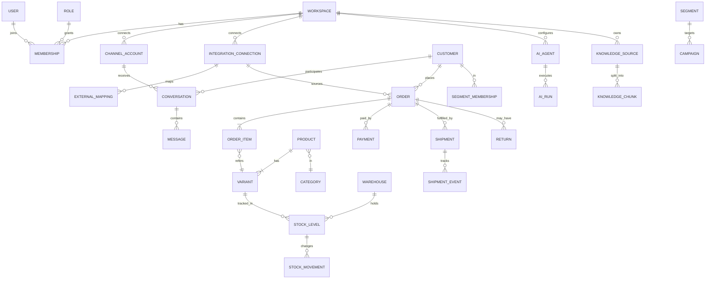

# Domain Model

Canonical entities shared by all features. Feature specs add feature-specific fields but MUST NOT redefine these entities.

## 1. Entity map

## 2. ID prefixes

| Entity | Prefix | Entity | Prefix |
| --- | --- | --- | --- |
| Workspace | `wsp_` | Shipment | `shp_` |
| User | `usr_` | Return | `ret_` |
| Membership | `mem_` | Warehouse | `whs_` |
| Channel account | `chn_` | Stock movement | `smv_` |
| Conversation | `cnv_` | Campaign | `cmp_` |
| Message | `msg_` | Segment | `seg_` |
| Customer | `cus_` | AI agent | `agt_` |
| Product | `prd_` | AI run | `run_` |
| Variant | `var_` | Knowledge source | `ksr_` |
| Order | `ord_` | Payment | `pay_` |
| Call | `cal_` | Courier account | `cou_` |
| Integration connection | `icn_` | External mapping | `map_` |
| Onboarding state | `ons_` | Sync job | `syn_` |
| Payment gateway account | `pga_` | Payment attempt | `pat_` |
| Payment link | `lnk_` | | |

## 3. Core entities

### Workspace
`id, name, slug, currency (BDT), timezone (Asia/Dhaka), default_language (bn|en), plan_id, status (trial|active|suspended), created_at`

### User and Membership
- `User`: `id, name, email?, phone?, password_hash?, locale, status`.
- `Membership`: `id, workspace_id, user_id, role_id, status (invited|active|disabled)`.

### ChannelAccount
`id, workspace_id, type (messenger|instagram|whatsapp|web_chat|telegram|email|tiktok|phone), external_id, display_name, credentials_encrypted, status (connected|error|disconnected), webhook_state, created_at`

### IntegrationConnection and ExternalMapping
Sales channels that are external **stores or systems** (as opposed to messaging `ChannelAccount`s). Full spec in `../02-customer-features/16-marketplace-integrations.md`.
- `IntegrationConnection`: `id, workspace_id, type (shopify|woocommerce|custom_api|daraz|chaldal), name, domain, credentials_encrypted, status (active|error|disconnected), capabilities[] (from the connector's capability manifest), settings{ field_ownership, sync_direction, stock_buffer, ... }, last_sync_at`
- `ExternalMapping`: `id, connection_id, entity_type (product|variant|customer|order|location), internal_id, external_id, active`. External IDs are namespaced, e.g. `shopify:store-123:product-456`; the same internal product may have many mappings. A Shopify and a WooCommerce product ID are never assumed to be the same product.

The **manual / no-website** mode needs no connection record: its records are created natively and carry `source = manual`.

### Customer
`id, workspace_id, name, phones[] (E.164), email?, addresses[], tags[], identities[] ({channel_type, external_id}), first_seen_at, last_seen_at, stats {orders_count, delivered_count, returned_count, cancelled_count, total_spent_amount, ltv_amount, last_order_at}, loyalty_score, risk_score, language_pref, opted_out {sms, whatsapp, messenger, email}, notes`

Identity resolution: one Customer can own many `identities`; merge by matching normalized phone first, then email, then manual merge.

### Conversation and Message
- `Conversation`: `id, workspace_id, channel_account_id, customer_id, status (open|pending|snoozed|resolved), assignee_user_id?, handled_by (ai|human|none), tags[], priority, last_message_at, first_response_due_at, resolved_at?`
- `Message`: `id, conversation_id, direction (in|out|internal_note), sender_type (customer|user|ai|system), sender_id?, content_type (text|image|audio|video|file|location|template|product_card|payment_link), body, attachments[], external_id, delivery_status (queued|sent|delivered|read|failed), created_at`
  - `attachments[]` item: `{type, mime, size, duration_secs?, storage_key, source_ref, download_status (pending|stored|failed), ai?}`; `ai` holds the vision result for images (`class`, `attributes`, `description`, `confidence`) and is filled by the AI step, never by the channel.
  - Voice notes (`content_type=audio`) also carry `transcript?, transcript_lang?, transcript_confidence?, transcript_status (pending|done|failed|skipped), transcript_edited_by?` (see `02-customer-features/01-omnichannel-inbox.md` FR-INB-16).

### Product, Variant, Category
- `Product`: `id, workspace_id, name, slug, description, category_id, type (physical|digital|bundle), status (draft|active|archived), images[], attributes{}, tags[], created_at`
- `Variant`: `id, product_id, sku, barcode?, options {size?, color?, ...}, price_amount, compare_at_amount?, cost_amount?, weight_g?, track_inventory (bool), status`
- `Category`: `id, workspace_id, name, parent_id?, slug`

### Warehouse, StockLevel, StockMovement
- `Warehouse`: `id, workspace_id, name, address, is_default, status`
- `StockLevel`: `variant_id, warehouse_id, on_hand, reserved, damaged, available (= on_hand - reserved - damaged)`
- `StockMovement`: `id, variant_id, warehouse_id, type (purchase|sale|return|transfer_in|transfer_out|damage|adjustment|reservation|release), quantity (signed), reference_type, reference_id, note, actor, created_at`

### Order and OrderItem
- `Order`: `id, number, workspace_id, customer_id, source (manual|ai|website|shopify|woocommerce|daraz|api), source_connection_id? (icn_ for store/API sources), channel_account_id? (chn_ for messaging origin), external_order_id?, owner (platform|connection), conversation_id?, status, payment_status (unpaid|partial|paid|refunded), fulfillment_status, items[], subtotal_amount, discount_amount, shipping_amount, total_amount, cod_amount, shipping_address, notes, fraud_score, created_by {actor_type, actor_id}, created_at`
- `OrderItem`: `id, order_id, variant_id, name_snapshot, sku_snapshot, unit_price_amount, quantity, discount_amount, total_amount`

Order status values (single source of truth): `new, confirmed, packed, shipped, delivered, returned, cancelled`.

### Payment
`id, order_id, method (cod|bkash|nagad|rocket|sslcommerz|aamarpay|shurjopay|portwallet|card|bank|cash), provider_account_id?, provider_txn_id?, livemode, fee_amount?, net_amount?, verification (provider_verified|manual_verified|unverified), method_detail?, amount, currency, status (pending|authorized|paid|failed|refunded|partially_refunded), payer_reference?, paid_at?, raw_payload`

### Shipment
`id, order_id, courier_account_id, courier (steadfast|pathao|redx|paperfly|ecourier|sundarban|manual), reference, attempt, consignment_id, tracking_code, tracking_url?, status (pending|booked|picked_up|in_transit|out_for_delivery|delivered|partially_delivered|on_hold|failed|returning|returned|cancelled|exception), confirmation (confirmed|pending), return_state (none|processing|rider_assigned|received), return_requested, courier_status_raw, cod_amount, cod_collected_amount?, delivery_charge_amount, cod_fee_amount, net_payable_amount?, settlement_status (pending|partial|settled|disputed), booked_at, delivered_at?`
Full courier tables (CourierAccount, ShipmentEvent, CourierWebhookEvent, settlement tables) and rules: `courier-adapter-framework.md` section 15 and `08-courier-integration.md`.

### Return
`id, order_id, shipment_id?, reason, items[], status (requested|approved|in_transit|received|refunded|rejected), restock (bool), refund_amount`

### Segment, Campaign
- `Segment`: `id, name, rules (JSON filter tree), type (dynamic|static), member_count, refreshed_at`
- `Campaign`: `id, channel (whatsapp|sms|messenger), segment_id, template_id, schedule_at, status (draft|scheduled|sending|sent|failed|cancelled), stats {sent, delivered, read, replied, converted}`

### AI Agent, AI Run, Knowledge
- `AIAgent`: `id, workspace_id, type (sales|order|call|business|support|inventory|marketing|finance|ceo), autonomy_level, enabled, config`
- `AIRun`: `id, agent_id, trigger, input_ref, steps[] (tool calls), output, status, tokens, latency_ms, provider, model, route, prompt_version, cost_estimate_amount, fallback_used, data_class, created_at`
- `AIProviderConfig` (platform-level, secrets in vault): `id, key, type (gemini|openai_compatible|...), base_url?, trust_level (internal|external_contracted|external_untrusted), allow_pii, capabilities (probed), enabled`
- `AIRoute` (platform-level with optional workspace override): `task_key, primary (provider:model), fallbacks[], params {temperature, max_output_tokens, reasoning}, enabled`
- `Workspace.ai_processing_mode`: `cloud_allowed | self_hosted_only`
- `KnowledgeSource`: `id, type (product|faq|policy|document|url|inventory|customer_history|courier_status), status, last_synced_at`
- `KnowledgeChunk`: `id, source_id, text, embedding, metadata`

## 4. Cross-entity rules
1. An `Order` item MUST snapshot name, sku and price at creation. Later catalog edits do not change old orders.
2. Stock is only changed through `StockMovement`. `StockLevel` is derived and MUST reconcile with the sum of movements.
3. `Order.status = delivered` requires a `Shipment.status = delivered` or a manual override with reason.
4. `Customer.stats` are denormalized; they are updated by order events and can be rebuilt by a backfill job.
5. Deleting a Product with orders is forbidden; archive it.
6. **Canonical first.** Every external order, product, customer or stock figure is translated into the canonical entities above; no feature code branches on `Order.source` for business rules (only for display, filtering and push-back).
7. **Order source is immutable; order owner is explicit.** `source` records where the order originated. `owner` records which system currently drives its lifecycle (e.g. a Shopify order is `connection`-owned until fulfillment is handled in the platform; a Messenger order is `platform`-owned). Status pushes go to the owner's counterpart only where the connector declares the capability.
8. **Intake is idempotent.** Orders from any external source dedupe on `(source_connection_id, external_order_id)`; replaying a webhook never creates a second order.
9. **Identity resolution is conservative.** Customers merge automatically only on a normalized phone or email match, never on name alone.
10. **Platform inventory is the stock ledger of record** unless a connection explicitly sets stock to read-only import; connectors push `available` out and import orders in, rather than importing store decrements (see `16-marketplace-integrations.md`).
